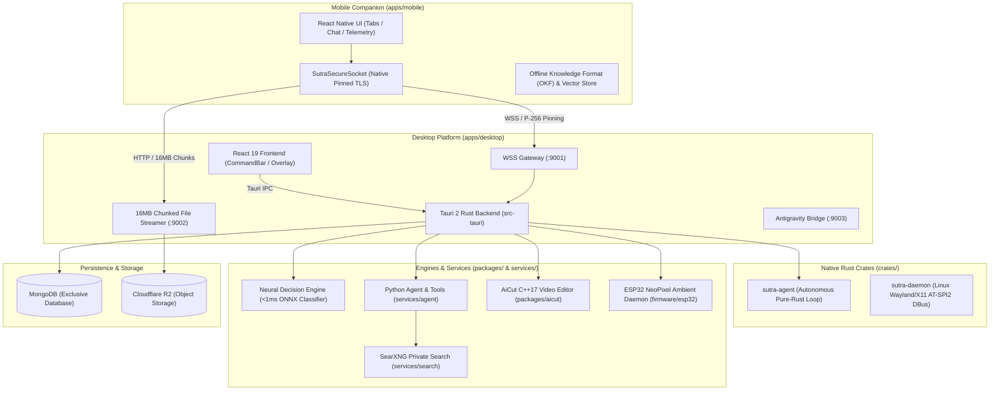
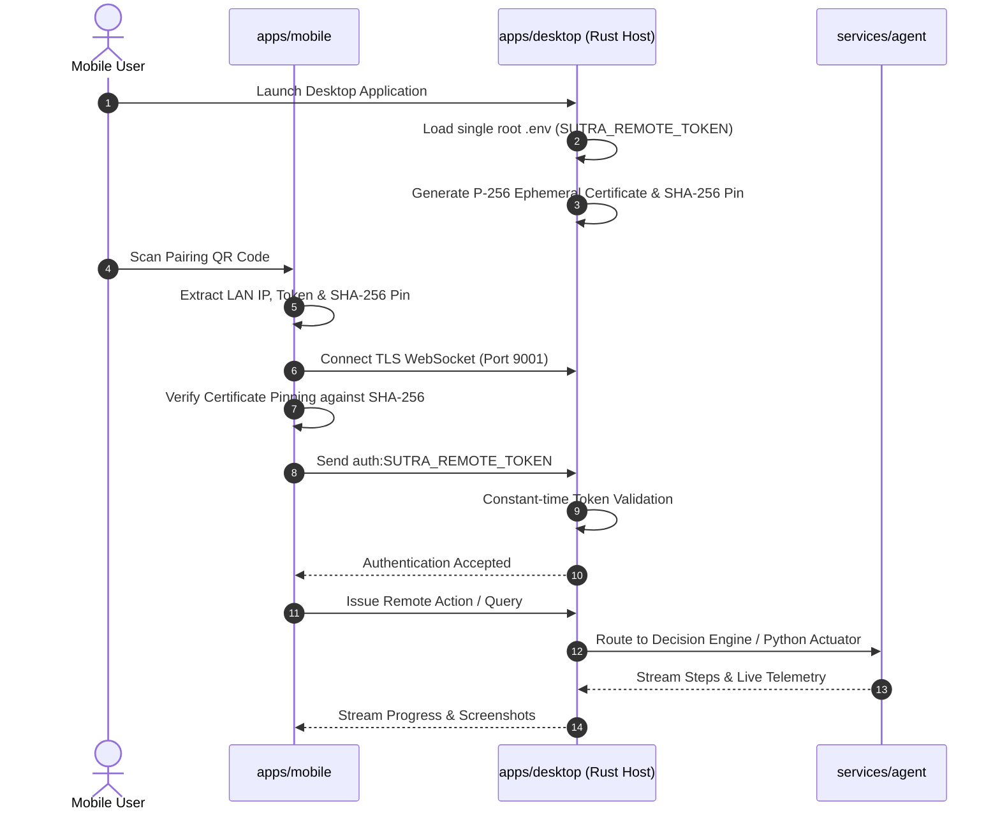

# Sutra System Architecture & Technical Specifications

This document outlines the architectural blueprint, module boundaries, subsystem responsibilities, security models, and runtime flows for **Sutra**.

---

## 1. High-Level Architecture Overview

Sutra is a hybrid, offline-first multimodal AI desktop tutor and automation system. It operates across three primary tiers:

1. **Desktop Tier (`apps/desktop` + `crates/`):** A Tauri 2 desktop host providing a high-performance native Rust core with a React 19 web interface, secure WebSocket server (port 9001), streaming file transfer service (port 9002), and Antigravity IDE bridge (port 9003).
2. **Mobile Tier (`apps/mobile`):** An Expo/React Native companion application with native Kotlin/Swift TLS certificate pinning and Android KeyStore credential encryption for remote PC orchestration, telemetry monitoring, and OKF document reasoning.
3. **Engine & Services Tier (`packages/` + `services/`):** High-speed System 1 neural decision routing, C++17 AiCut video editing, Python multimodal agent services, SearXNG private search, and ESP32 ambient status hardware.



---

## 2. Monorepo Structure & Module Boundaries

The project is structured with strict boundary separation between platform-specific code, shared logic, and standalone modules:

```
sutra/
├── apps/
│   ├── desktop/                # Tauri 2 Desktop Host & React 19 Frontend
│   └── mobile/                 # React Native / Expo Companion with Native Modules
├── crates/
│   ├── sutra-agent/            # Pure-Rust Autonomous Agent Loop
│   └── sutra-daemon/           # Headless Linux Wayland/X11 Daemon
├── packages/
│   ├── aicut/                  # C++17 Video Processing Engine & MCP Server
│   ├── decision-engine/        # <1ms ONNX Reflex Classification Model
│   └── shared/                 # Common JSON Schemas and Contracts
├── services/
│   ├── agent/                  # Python Agent, Multimodal Vision, Wake Word
│   └── search/                 # SearXNG Private Web Search
├── firmware/
│   └── esp32/                  # ESP32 Ambient Status Firmware
├── scripts/
│   ├── build/                  # Production Bundling & Runtime Preparation
│   ├── dev/                    # Development Process Management
│   ├── platform/               # OS Setup, Checkers & Diagnostics
│   └── tools/                  # Utility Scripts & Test Harnesses
└── docs/                       # Architecture, Guides, Plans, Specifications
```

### Module Responsibilities

#### `apps/desktop`
- **UI Subsystem (`apps/desktop/src`):** React 19 frontend rendered inside transparent or overlaid Webview windows. Implements the keyboard-driven `CommandBar`, window-capture exclusion overlays (`WDA_EXCLUDEFROMCAPTURE`), guidance step visualizers, and speech synthesis bridges.
- **Native Host (`apps/desktop/src-tauri`):** Tauri 2 desktop host responsible for OS-level event listeners, window management, process supervision, P-256 self-signed certificate generation, WebSocket server (:9001), streaming file receiver (:9002), and desktop IPC.

#### `apps/mobile`
- **Companion UI (`apps/mobile/components`):** Cross-platform React Native client with tabs for Autopilot Chat, Document RAG (Notebook Hub), System Telemetry, File Navigation, and Settings.
- **Native Security (`apps/mobile/modules/sutra-secure-socket`):** Custom Expo/Android native module implementing OkHttp TLS SHA-256 certificate public-key pinning and Android KeyStore AES-256 GCM credential encryption. Ensures zero plain-text token transmission over unverified networks.

#### `crates/sutra-agent`
- **Pure-Rust Autonomous Agent:** Provides a standalone, memory-safe, ultra-low latency execution loop. Capable of multi-provider LLM calling (OpenAI, Gemini, Groq, Ollama), managing native tool registries, and maintaining embedded SQLite vector search.

#### `crates/sutra-daemon`
- **Linux Headless Daemon:** Native background daemon for Linux Wayland (Hyprland, Sway, wlroots) and X11 sessions. Bypasses GUI toolkits by interfacing directly with `/dev/uinput` for input injection, AT-SPI2 DBus for accessibility trees, and PipeWire for high-framerate desktop capture.

#### `packages/decision-engine`
- **System 1 Neural Reflex:** A non-autoregressive ONNX Transformer classifier running in sub-millisecond time (<1ms). Classifies user intents into immediate reflex actions, computer-use automation, or complex research pipelines before engaging heavy LLM calls.

#### `packages/aicut`
- **C++17 Video Editing Engine:** Native video processor using CMake, OpenCV, and faster-whisper. Performs automatic silence elimination, forced word-level alignment, and smart video clipping with an integrated Model Context Protocol (MCP) server.

#### `services/agent`
- **Multimodal Intelligence:** Python 3.11+ service implementing UI element detection, OCR extraction (WinRT OCR / Tesseract / OmniParser), browser control, and offline wake-word detection using `hey_sutra.onnx` via ONNX Runtime.

---

## 3. Storage & Data Persistence

### Database: MongoDB Exclusively
In adherence to core project requirements:
- **MongoDB is the sole database engine.**
- All persistent user chat threads, notebook metadata, document citations, and configuration states connect via `MONGODB_URI` specified in the root `.env`.
- No secondary databases (e.g. Postgres, MySQL, DynamoDB) are introduced.

### Object Storage: Cloudflare R2
- Any large-file artifacts, media uploads from mobile transfers, and video export assets destined for cloud storage utilize **Cloudflare R2** via standard S3-compatible APIs.
- Configured through `CLOUDFLARE_R2_ACCOUNT_ID`, `CLOUDFLARE_R2_ACCESS_KEY_ID`, `CLOUDFLARE_R2_SECRET_ACCESS_KEY`, and `CLOUDFLARE_R2_BUCKET_NAME`.

---

## 4. Security & Cryptographic Boundaries



### Security Guarantees:
1. **Loopback vs. Remote Boundaries:** Loopback requests (127.0.0.1) are treated as local desktop interactions. Any non-loopback connections from LAN/Wi-Fi require strict `SUTRA_REMOTE_TOKEN` validation.
2. **Pinned TLS in Release Mode:** Release builds mandate WSS with SHA-256 certificate pinning. Untrusted or man-in-the-middle certificates are instantly terminated by the native mobile module.
3. **Environment Security:** Exactly one `.env` file exists at the root. Secrets are never embedded or bundled into client-side JavaScript.
4. **Window Exclusion:** Overlay guidance windows utilize `WDA_EXCLUDEFROMCAPTURE` on Windows and equivalent Wayland/X11 surface masking to prevent recursive screenshot artifacts.

---

## 5. Development & Verification Lifecycle

The entire monorepo strictly utilizes **npm** for package lifecycle management:

```bash
# Typecheck
npm run typecheck

# Cargo workspace verification
cargo check --workspace

# Python compilation verification
python3 -m compileall -q services/agent packages/aicut packages/decision-engine scripts

# Development execution
npm run dev
```
